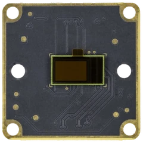
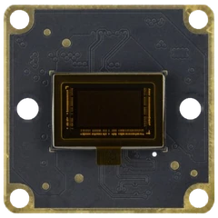
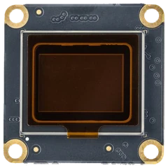
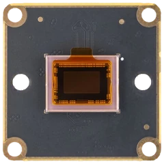
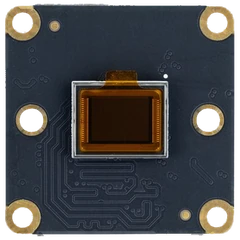
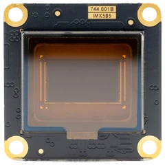
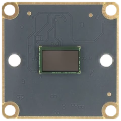

  <a href="https://www.kurokesu.com">
    <picture>
      <source media="(prefers-color-scheme: dark)" srcset="img/logo-dark.webp">
      
    </picture>
  </a>

  Open source drivers, apps, SDKs and design files for Kurokesu MIPI CSI-2 cameras, lenses and controllers

  <a href="https://www.kurokesu.com">Shop</a> |
  <a href="https://www.kurokesu.com/Knowledge-Base/">Knowledge Base</a> |
  <a href="https://apt.kurokesu.com">apt archive</a>

<pre><b>$ ls github/kurokesu/
<a href="https://github.com/search?q=org%3AKurokesu+topic%3Araspberry-pi+fork%3Atrue+archived%3Afalse&amp;type=repositories">raspberry-pi</a>  <a href="https://github.com/search?q=org%3AKurokesu+topic%3Anvidia-jetson+fork%3Atrue+archived%3Afalse&amp;type=repositories">nvidia-jetson</a>  <a href="https://github.com/search?q=org%3AKurokesu+topic%3Anxp+fork%3Atrue+archived%3Afalse&amp;type=repositories">nxp-imx95</a></b></pre>

## Camera drivers for Raspberry Pi, NVIDIA Jetson and NXP i.MX 95

<table>
  <tr>
    <td colspan="3" align="center" valign="top" width="25%">
      <b>onsemi AR0234</b> 
       
      2.3 MP, global shutter, external trigger 
      <a href="https://www.kurokesu.com/item/234C-CSI"><b>234C-CSI</b></a>
    </td>
    <td colspan="3" align="center" valign="top" width="25%">
      <b>onsemi AR0822</b> 
       
      8 MP, HDR 
      <a href="https://www.kurokesu.com/item/822C-CSI"><b>822C-CSI</b></a>
    </td>
    <td colspan="3" align="center" valign="top" width="25%">
      <b>Sony IMX283</b> 
       
      20 MP, 1-inch 
      <a href="https://www.kurokesu.com/item/283C-CSI"><b>283C-CSI</b></a>
    </td>
    <td colspan="3" align="center" valign="top" width="25%">
      <b>Sony IMX462</b> 
       
      2.1 MP, STARVIS low light 
      <a href="https://www.kurokesu.com/item/462C-CSI"><b>462C-CSI</b></a>
    </td>
  </tr>
  <tr>
    <td align="center" width="58"><a href="https://github.com/Kurokesu/ar0234-rpi-driver">RPi</a></td>
    <td align="center" width="87"><a href="https://github.com/Kurokesu/ar0234-jetson-driver">Jetson</a></td>
    <td align="center" width="58"></td>
    <td align="center" width="58"><a href="https://github.com/Kurokesu/ar0822-rpi-driver">RPi</a></td>
    <td align="center" width="87"></td>
    <td align="center" width="58"></td>
    <td align="center" width="58"><a href="https://wiki.kurokesu.com/books/raspberry-pi-and-imx283-and-imx477-csi-2-cameras-how-to/page/raspberry-pi5-and-cm5-bookworm"><code>RPi</code></a></td>
    <td align="center" width="87"><a href="https://github.com/Kurokesu/imx283-jetson-driver">Jetson</a></td>
    <td align="center" width="58"></td>
    <td align="center" width="58"><a href="https://wiki.kurokesu.com/books/raspberry-pi-and-imx462-csi-2-camera-how-to/page/raspberry-pi-5-bookworm"><code>RPi</code></a></td>
    <td align="center" width="87"><a href="https://github.com/Kurokesu/imx462-jetson-driver">Jetson</a></td>
    <td align="center" width="58"><a href="https://github.com/Kurokesu/meta-kurokesu-imx95">i.MX</a></td>
  </tr>
  <tr>
    <td colspan="3" align="center" valign="top" width="25%">
      <b>Sony IMX477</b> 
       
      12.3 MP, 4-lane, HQ Camera 
      <a href="https://www.kurokesu.com/item/477C-CSI"><b>477C-CSI</b></a>
    </td>
    <td colspan="3" align="center" valign="top" width="25%">
      <b>Sony IMX585</b> 
       
      8.3 MP, STARVIS 2 HDR 
      <a href="https://www.kurokesu.com/item/585C-CSI"><b>585C-CSI</b></a>
    </td>
    <td colspan="3" align="center" valign="top" width="25%">
      <b>OmniVision OS08E10</b> 
       
      8.3 MP, near-infrared 
      <a href="https://www.kurokesu.com/item/0810-CSI"><b>0810-CSI</b></a>
    </td>
    <td rowspan="2" colspan="3" valign="middle" width="25%">
<pre><b>$ make next-sensor
make: *** Waiting
for your input at
<a href="mailto:info@kurokesu.com">info@kurokesu.com</a>
$ █</b></pre>
    </td>
  </tr>
  <tr>
    <td align="center" width="58"><a href="https://github.com/Kurokesu/imx477-rpi-driver">RPi</a></td>
    <td align="center" width="87"><code>Jetson</code></td>
    <td align="center" width="58"></td>
    <td align="center" width="58"><a href="https://github.com/Kurokesu/imx585-rpi-driver">RPi</a></td>
    <td align="center" width="87"><a href="https://github.com/Kurokesu/imx585-jetson-driver">Jetson</a></td>
    <td align="center" width="58"></td>
    <td align="center" width="58"><a href="https://github.com/Kurokesu/os08e10-rpi-driver">RPi</a></td>
    <td align="center" width="87"></td>
    <td align="center" width="58"></td>
  </tr>
</table>

*Boxed platform slot means driver ships with OS*

## Camera stack

- [libcamera](https://github.com/Kurokesu/libcamera): Raspberry Pi camera stack fork
- [rpicam-apps](https://github.com/Kurokesu/rpicam-apps): Raspberry Pi capture apps fork

## Applications

- [camlab-rpi](https://github.com/Kurokesu/camlab-rpi): Raspberry Pi app for camera bring-up and evaluation
- [cinepi-kurokesu](https://github.com/Kurokesu/cinepi-kurokesu): Raspberry Pi cinema camera with raw DNG recording

## Lenses and motion

- [SCF4-SDK](https://github.com/Kurokesu/SCF4-SDK): SCF4 zoom lens controller
- [SCE2-SDK](https://github.com/Kurokesu/SCE2-SDK): SCE2-M lens controller, firmware in [SCE2-GRBL](https://github.com/Kurokesu/SCE2-GRBL)
- [motorized_zoom_lens](https://github.com/Kurokesu/motorized_zoom_lens): motorized CS zoom lens controller

## Resources and tools

- [3d_models](https://github.com/Kurokesu/3d_models): CAD models of Kurokesu products
- [datasheets](https://github.com/Kurokesu/datasheets): product datasheets
- [C1_SONIX_Test_AP](https://github.com/Kurokesu/C1_SONIX_Test_AP): settings tool for UVC USB cameras
- [ssh-keyup](https://github.com/Kurokesu/ssh-keyup): quick passwordless SSH key management for Linux and RouterOS devices

## Open and dependable

<table>
  <tr>
    <td valign="top" width="20%">
      <b>Open for good</b> 
      Source code, packages, CAD models and datasheets stay public
    </td>
    <td valign="top" width="20%">
      <b>Plug and play</b> 
      One <code>apt install</code> on Raspberry Pi, one <code>setup.sh</code> on Jetson. DKMS keeps drivers across kernel updates
    </td>
    <td valign="top" width="20%">
      <b>Signed apt updates</b> 
      Features and fixes arrive with <code>apt upgrade</code>, older versions stay available for pinning
    </td>
    <td valign="top" width="20%">
      <b>Customizable</b> 
      Drivers are highly configurable to cover sensor capabilities, open to fork for special applications
    </td>
    <td valign="top" width="20%">
      <b>Long-term availability</b> 
      Modules and drivers stay available for years
    </td>
  </tr>
</table>

## Contributing

Feature requests, bug reports and PRs are welcome. Missing a sensor or platform? Contact us at [info@kurokesu.com](mailto:info@kurokesu.com)
